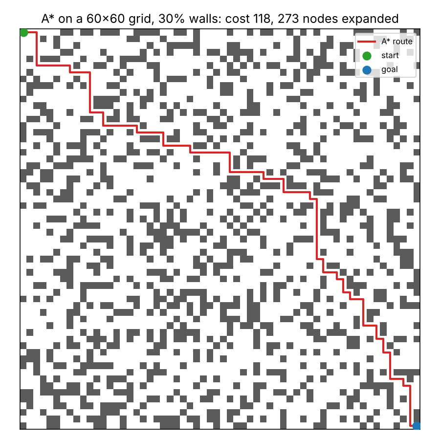

# Grid Routing: BFS vs Dijkstra vs A*

Shortest path search on a random 4 connected grid, implemented in Python with NumPy. The project compares three algorithms on correctness (do they find the same optimal cost?) and work done (how many cells do they expand?).



## What it does

- `routing.py`: grid generation and three searches that return `(cost, path, nodes_expanded)`.
  - **BFS**: queue based, optimal because every step costs 1.
  - **Dijkstra**: priority queue ordered by cost so far (`g`).
  - **A\***: priority queue ordered by `g + h`, with `h` = Manhattan distance to the goal. Dijkstra and A* share one function; Dijkstra is A* with `h = 0`.
- `benchmark.py`: 50 random grids per wall density, 100x100, corner to corner.
- `plot_example.py`: draws one grid with the A* route (`example.png`).

Implementation notes:
- Python's `heapq` has no decrease key, so cheaper routes are pushed as new entries and outdated ones are skipped when popped.
- Heap entries are `(f, -g, cell)`: among equal `f`, the cell with larger `g` is expanded first. This tie break matters a lot for A* on grids, where many cells share the same `f`.
- The goal is detected when it is *popped*, not when first pushed, which is what guarantees optimality.

## Run it

```bash
pip install -r requirements.txt
python routing.py        # correctness checks and a small demo
python benchmark.py      # results table
python plot_example.py   # writes example.png
```

## Results

50 seeds per row, 100x100 grid, start (0,0), goal (99,99). Expanded node counts are means over solvable grids only.

| Walls | Solvable | No route | Mean cost | BFS expanded | Dijkstra expanded | A* expanded | A* / Dijkstra |
|---|---|---|---|---|---|---|---|
| 10% | 50 | 0 | 198.0 | 8995 | 8995 | 600 | 0.07 |
| 25% | 30 | 20 | 198.5 | 7436 | 7436 | 1190 | 0.16 |
| 35% | 15 | 35 | 213.6 | 6035 | 6036 | 1857 | 0.31 |

What the numbers show:
- All three algorithms returned the same optimal cost on every solvable grid (asserted in the benchmark).
- BFS and Dijkstra do essentially identical work. With unit step costs, the priority queue gives no advantage over a plain queue.
- A* expands far fewer cells, but its advantage shrinks as walls increase, because the Manhattan heuristic ignores obstacles and becomes less informative.
- The many "no route" grids at 25% and 35% walls are real, not a bug. I cross checked them with an independent connected components count (`scipy.ndimage.label`) and got the same 20/50 and 35/50. The start and goal are corner cells with only two neighbours each, so they are easily boxed in by walls.

## Limitations

- 4 connected moves and unit step costs only, so Dijkstra has no advantage over BFS here.
- Random uniform obstacles; real maps have structure (roads, rooms, corridors) that changes how well the heuristic performs.
- One grid size and one start/goal pair; timing was not benchmarked, only nodes expanded.

## Future work

- Weighted terrain (cells with different costs), where Dijkstra's heap becomes necessary and BFS is no longer correct.
- Diagonal moves with an admissible heuristic (octile distance), plus a test that an inadmissible heuristic returns a suboptimal path.
- Wall clock timing and larger or structured maps.
